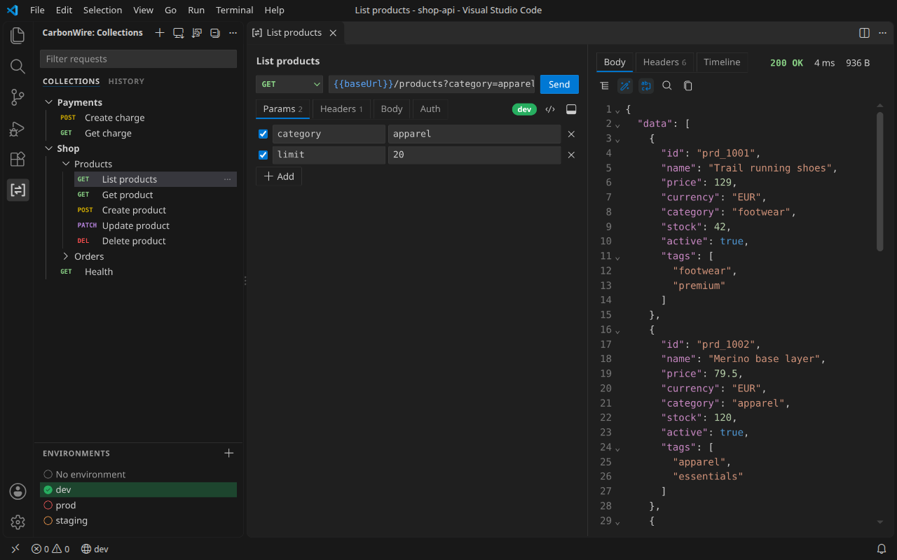
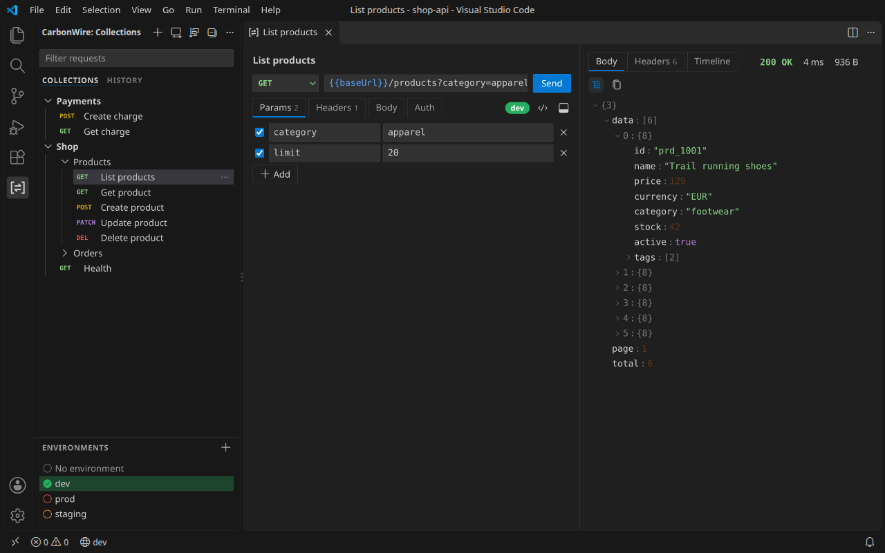
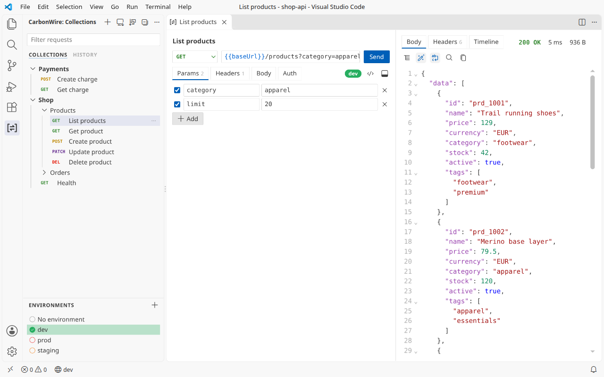
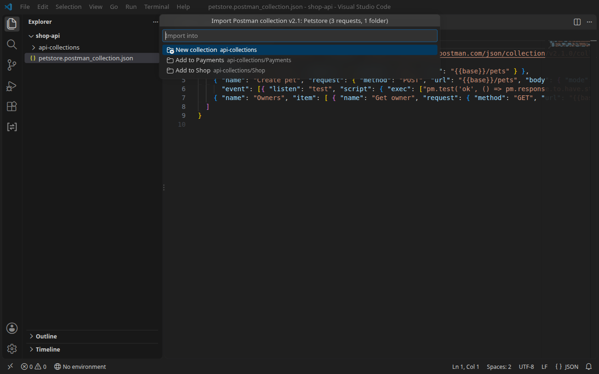

# CarbonWire

**A fast REST API client for VS Code.** Send HTTP requests, inspect responses and keep your API collections as plain files next to your code. Bring your collections over from Postman, Insomnia and Bruno, or just paste a curl command.

CarbonWire is free and open source, under the MIT license. Also [available for Obsidian](#also-for-obsidian).



## Why CarbonWire

- **Fast.** Requests go straight to the server over kept-alive connections, with nothing added in between. Large JSON responses are formatted in the background, so the editor stays responsive.
- **Your files, your repository.** Collections are plain YAML files in the OpenCollection format that Bruno uses. Commit them with your code, review them in pull requests, and open Bruno's YAML collections as they are.
- **Bring everything with you.** Import from Postman, Insomnia, Bruno, HTTPie, Hoppscotch, curl, HAR and `.http` files, environments included.
- **Everything you reach for.** OAuth 2.0 sign-in in the browser, AWS, NTLM and eight more auth types, cookies, proxies, client certificates, HTTP/2, code snippets and a console that shows each request as it was sent.
- **Private by design.** No account, no cloud, no telemetry. Requests go only where you send them, and secrets stay in VS Code's secret storage, never in your files.
- **Open source.** All the code is [on GitHub](https://github.com/carbonconfig/CarbonWire_VSCode) under the MIT license, so you can see exactly what it does with your requests.

## Quick start

1. Open a folder, then select the CarbonWire icon in the Activity Bar.
2. Select **+** in the view's title bar and choose **New collection**, or select **Import** to bring in a Postman, Insomnia or Bruno collection.
3. Choose **+ → New request**, type a URL or paste a curl command, and press `Ctrl+Enter` (`Cmd+Enter` on macOS).
4. Press `Ctrl+S` (`Cmd+S`) to save the request to a collection. From then on, changes save automatically.

## Features

**Requests**
- Any method, query and path parameters, headers, and JSON, XML, text, form, multipart or file bodies
- `{{variables}}` everywhere, shown in blue when defined and red when not, plus Postman's dynamic values: `{{$guid}}`, `{{$timestamp}}`, `{{$randomEmail}}` and about 120 more
- Auth: Basic, Bearer token, API key, Digest, OAuth 2.0 (authorization code with PKCE, implicit, client credentials and password), OAuth 1.0, AWS Signature v4, NTLM, Hawk, Akamai EdgeGrid, JWT Bearer, ASAP and WSSE. Authorization code and implicit sign in through your browser.
- Settings for each request, folder or collection: timeout, redirects (how many, keeping the method or the Authorization header), URL encoding, HTTP/1.1 or HTTP/2, certificate checks, TLS versions and cipher suites, cookies, and which default headers to send
- Paste a curl command into the URL bar and the whole request fills in. Copy any request back out as curl.
- The request as code: cURL, raw HTTP, JavaScript `fetch`, Python `requests` or Go
- Header presets: save a set of headers once and add it to any request
- Start a request without saving it, then save it to a collection when you want to keep it

**Responses**
- Status, time and size at a glance, with live progress while connecting, waiting and downloading
- Pretty-printed, searchable JSON with syntax colouring, and a JSON tree for large payloads: right-click a value to copy it or its path
- Filter JSON with JSONPath, such as `$.items[?@.active].id`
- HTML preview, images and PDFs right in the tab
- Headers, cookies, a timing breakdown (DNS, connect, TLS, waiting and download), and the connection: address, TLS version, cipher and the certificate chain
- Save a response body to a file, or keep it with the request as a saved example



**Collections and environments**
- Collections and folders share variables, headers, auth and settings with every request inside them, and can have docs, written in Markdown
- Globals: variables for every collection, whichever environment is active
- One list of environments, one active at a time, each with its own colour, shown in the status bar. Names like dev, test, staging and prod get matching colours automatically.
- Drag to reorder or move requests, folders, collections and environments. Sort by name, creation or last update.
- Right-click anything in the sidebar for its actions, or use the keyboard: arrow keys move through the tree, `Shift+F10` opens the menu.

**History and the console**
- Every request you send is kept with its response, saved or not
- Open a request and its last response is already there
- Kept on this device, for this workspace, and never in your repository
- The console, in the panel, shows each request as it went out, after variables, auth, cookies and redirects, with what came back

**Network**
- A cookie jar: cookies responses set are sent with later requests to the same site. See and edit them in the cookie manager.
- Proxies: HTTP, HTTPS and SOCKS5, with a user name and password, set for CarbonWire or taken from the environment or VS Code
- Client certificates for mutual TLS, per host (PEM or PKCS #12), and your own certificate authorities

**Export**
- Collections as Postman v2.1 JSON, Postman v3 YAML, an OpenCollection zip, a cURL script or HAR. Environments as Postman JSON or YAML.



## Performance

| Task | Time |
|---|---|
| Find 5,000 requests in a workspace and list them for the sidebar | 120–230 ms |
| Open a request tab | 150–300 ms |
| A GET through CarbonWire compared with Node's own HTTP client in VS Code | faster: 0.3–0.5 ms against 0.6–0.9 ms |
| Show a 10 MB JSON response, pretty-printed | under half a second |
| CarbonWire's own startup work | 5–10 ms |
| Extension download | under 900 KB, nothing downloaded at runtime |

CarbonWire connects to servers directly, so connections are reused between requests. VS Code's own proxy support otherwise opens a new connection for every request, which is why a GET through CarbonWire is quicker than through Node's HTTP client inside VS Code. When you use a proxy, CarbonWire goes through VS Code's proxy settings instead; see **Proxy** below.

Ranges of medians over several runs on an Intel Core i5-1135G7 laptop with VS Code 1.141; they vary with what else the machine is doing. Run `npm run test:perf` to measure on your own machine.

## Import from

| Source | What comes across |
|---|---|
| Postman | Collections (v2.0 and v2.1) and environments |
| Insomnia | v4 JSON and v5 YAML exports, with environments |
| Bruno | `.bru` collections and OpenCollection YAML folders |
| HTTPie | Desktop and web exports |
| Hoppscotch | Collections and environments |
| curl | Any command, pasted or imported |
| HAR | Browser network exports |
| `.http` files | JetBrains HTTP Client and VS Code REST Client, with `http-client.env.json` |

Import from a file, a folder, the clipboard or the file open in the editor. You can also right-click a file or folder in the Explorer and choose **Import into CarbonWire**. Anything that doesn't carry over as it was, such as scripts, is listed after the import.

Auth that OpenCollection files have no place for (Hawk, Akamai EdgeGrid, JWT Bearer and ASAP) and a few of Postman's request settings are kept beside the collection in `.carbonwire/collection.json`, which CarbonWire for Obsidian reads too. Other apps send those requests without that auth.



## Keyboard shortcuts

| Action | Shortcut |
|---|---|
| Send the request | `Ctrl+Enter` (`Cmd+Enter`), or `Enter` in the URL bar |
| Save an unsaved request | `Ctrl+S` (`Cmd+S`) |
| Find in the response or body | `Ctrl+F` (`Cmd+F`) |
| Move through the sidebar | Arrow keys, `Home` and `End` |
| Open a sidebar item's menu | `Shift+F10`, or right-click |

Commands in the Command Palette: **CarbonWire: Open collections**, **New request**, **New collection**, **New environment**, **Select environment**, **Edit globals**, **Import collection, environment or cURL**, **Import environment**, **Send request**, **Open console**, **Manage cookies**, **Clear OAuth 2.0 tokens**, **Set proxy password**, **Set client certificate passphrase** and **Clear history**. Assign your own keyboard shortcuts to any of them.

## Settings

| Setting | Default | What it does |
|---|---|---|
| `carbonwire.collectionsFolder` | `api-collections` | Where new collections are created, relative to the workspace folder. Existing collections are found anywhere in the workspace. |
| `carbonwire.environmentsFolder` | `api-collections/environments` | Where environments are kept. They're shared by every collection. |
| `carbonwire.responseSizeLimit` | 20 | In megabytes. Larger bodies are cut short in memory; the full size is still shown. |
| `carbonwire.historySize` | 100 | How many recent requests to keep. Set to 0 to turn history off. |
| `carbonwire.wrapLongLines` | On | Wraps long lines in responses instead of scrolling sideways. Also on the response toolbar. |
| `carbonwire.verifyTlsCertificates` | On | Turn off only for local servers with self-signed certificates. |
| `carbonwire.proxy` | `auto` | How requests reach the server; see **Proxy**. |
| `carbonwire.proxyUrl` | | For a custom proxy: `http://proxy:3128`, `https://proxy:443` or `socks5://user@proxy:1080`. |
| `carbonwire.proxyBypass` | `localhost, 127.0.0.1, ::1` | Hosts that skip the custom proxy. |
| `carbonwire.clientCertificates` | | Client certificates by host: a PEM certificate and key, or a PKCS #12 file. |
| `carbonwire.caCertificates` | | PEM files of certificate authorities to trust besides your system's. |
| `carbonwire.keepHiddenTabsLoaded` | Off | Keeps tabs loaded while hidden, so switching back is instant, at the cost of memory for each open tab. |

### Proxy

- **auto** (default): uses VS Code's proxy settings when a proxy is set in `http.proxy` or in the `HTTP_PROXY` or `HTTPS_PROXY` environment variables. Otherwise it connects directly.
- **vscode**: always goes through VS Code's proxy support, including a proxy VS Code finds in your system settings.
- **environment**: uses the proxy in `HTTP_PROXY`, `HTTPS_PROXY` or `ALL_PROXY`, skipping the hosts in `NO_PROXY`.
- **custom**: uses `carbonwire.proxyUrl`, skipping the hosts in `carbonwire.proxyBypass`. Set its password with **CarbonWire: Set proxy password**.
- **direct**: always connects directly.

With **environment** and **custom**, CarbonWire connects through the proxy itself, so HTTPS and SOCKS5 proxies work and connections are reused.

### Client certificates

Add one entry per host to `carbonwire.clientCertificates`:

```json
"carbonwire.clientCertificates": [
  { "host": "api.example.com", "certificate": "certs/client.pem", "key": "certs/client.key" },
  { "host": "*.internal.example.com:8443", "pfx": "certs/client.p12" }
]
```

Paths can be relative to the first workspace folder. Set a passphrase with **CarbonWire: Set client certificate passphrase**; it's kept in VS Code's secret storage, never in your settings.

If requests to outside servers fail with a network error and your network needs a proxy that's only in your system settings, choose **vscode**.

## Requirements

- VS Code 1.105 or later on Windows, macOS or Linux. CarbonWire is also published on Open VSX for Cursor, Windsurf, VSCodium and other editors based on VS Code.
- A trusted workspace. In Restricted Mode CarbonWire is turned off, because a request could otherwise read files from your computer or turn off certificate checks through workspace settings.
- With Remote - SSH, WSL, Dev Containers or Codespaces, CarbonWire runs where the workspace is, so `localhost` means that machine and requests are sent from there.
- Workspaces opened from a virtual file system, such as vscode.dev or GitHub repositories opened in the browser, aren't supported.

## Also for Obsidian

CarbonWire is also an Obsidian plugin, with the same features, for keeping API collections next to your notes. Both use the same plain YAML files, so a collection made in one opens in the other.

- [CarbonWire in Obsidian's community plugins](https://community.obsidian.md/plugins/carbonwire), or search for **CarbonWire** under **Settings → Community plugins → Browse**
- [Source on GitHub](https://github.com/carbonconfig/CarbonWire_Obsidian)

## Privacy and network use

- CarbonWire sends requests only to the URLs you enter, and only when you send them. For OAuth 2.0 it also calls the token URL you set, including when you copy a request as curl. Through a proxy you set, requests go to the proxy.
- For OAuth 2.0 authorization code and implicit sign-in, CarbonWire opens the provider's page in your browser and listens on `127.0.0.1` for the redirect, on the callback URL's port or any free one, until the sign-in finishes or 5 minutes pass.
- There's no telemetry and no account.
- A request body can be a file anywhere on your computer, such as `-F file=@/path/to/report.pdf` in an imported curl command. CarbonWire reads that file only when you send the request, and never writes outside your workspace.
- Secret environment values, the proxy password and certificate passphrases are kept in VS Code's secret storage (your system's keychain), never in your files.
- Client certificates and certificate authorities are read from the files you name in the settings, when you first send a request.
- Cookies are kept for this workspace on this device, in VS Code's storage, never in your repository. Delete them in the cookie manager.
- Header presets and the auth and settings OpenCollection files can't hold are written in `.carbonwire/` folders in your workspace, so they're shared with your collections.
- History, including response bodies up to 1 MB each, is kept in VS Code's storage for this workspace on this device, never in your repository. Requests are stored as written, so secrets aren't copied into history. Clear it from the History tab or turn it off in settings.
- HTML previews run no scripts and load nothing from the network.

## Coming next

- [ ] Run a request once for each row of a CSV file or pasted list, with assertions to check every response
- [ ] GraphQL
- [ ] gRPC
- [ ] WebSocket and server-sent events
- [ ] OpenAPI import
- [ ] Pre-request and test scripts, with a collection runner
- [ ] Code snippets for more languages
- [ ] Move a whole Postman account in one go

## Development

Requires Node 24 (`nvm use`).

```sh
npm install
npm run dev               # rebuild on change
npm test                  # unit and transport tests
npm run test:integration  # tests inside VS Code 1.105 and the current release
npm run test:perf         # timings inside VS Code, on a workspace of 5,000 requests
npm run bench             # performance benchmarks of the core
npm run lint
npm run build             # type-check and production build
npm run package           # build carbonwire-<version>.vsix
```

To try it, open this folder in VS Code and press `F5`. A second VS Code window opens with CarbonWire loaded.

`npm run test:perf` can also time a large JSON response, which needs several gigabytes of free memory: `CARBONWIRE_PERF_JSON_MB=50 npm run test:perf`.

## License

CarbonWire is open source under the [MIT license](LICENSE). Bug reports and ideas are welcome in [GitHub issues](https://github.com/carbonconfig/CarbonWire_VSCode/issues).

Icons are [Codicons](https://github.com/microsoft/vscode-codicons) by Microsoft, licensed under [CC BY 4.0](https://creativecommons.org/licenses/by/4.0/).

The extension includes other open source packages; `THIRD_PARTY_NOTICES.txt` in the installed extension lists them with their licenses.
